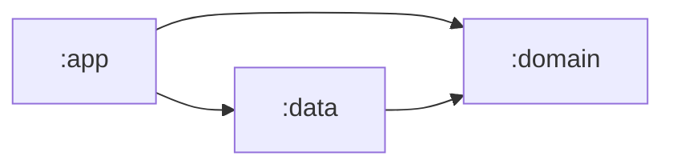

# Arquitectura

Este documento explica cómo está organizado el proyecto en módulos Gradle, por qué se ha hecho así y qué reglas debe respetar cualquier cambio. Las decisiones funcionales (cancelación, cache, errores) están en el [README](README.md#decisiones-principales).

## Un proyecto Gradle multimódulo

Cada carpeta con su propio `build.gradle.kts` es un **módulo independiente**, con sus propias dependencias y su propio resultado de compilación. En un proyecto de un solo módulo solo existe `app/build.gradle.kts`; aquí hay tres.

```
book-search-engine-tht/
├── settings.gradle.kts       ← declara qué módulos existen
├── build.gradle.kts          ← raíz: registra plugins y versiones (apply false)
├── gradle/libs.versions.toml ← catálogo de versiones compartido
├── app/build.gradle.kts      ← módulo Android application (genera el APK)
├── data/build.gradle.kts     ← módulo Android library (genera un .aar)
└── domain/build.gradle.kts   ← módulo Kotlin/JVM puro (genera un .jar)
```

### Qué hace cada fichero de build

- **`settings.gradle.kts`** registra los módulos. Sin esto, Gradle ignoraría las carpetas:

  ```kotlin
  include(":app")
  include(":domain")
  include(":data")
  ```

- **`build.gradle.kts` (raíz)** no compila nada. Solo declara los plugins con `apply false`, para que todos los módulos usen la misma versión.

- **`gradle/libs.versions.toml`** es el *version catalog*: la única fuente de versiones de librerías y plugins, a la que los módulos se refieren como `libs.xxx`.

- **El `build.gradle.kts` de cada módulo** aplica sus plugins y declara de qué módulos depende:

  ```kotlin
  // data/build.gradle.kts
  dependencies {
      implementation(project(":domain"))
  }

  // app/build.gradle.kts
  dependencies {
      implementation(project(":domain"))
      implementation(project(":data"))
  }
  ```

## Grafo de dependencias



Las flechas siempre apuntan hacia `:domain`, el núcleo, que no depende de ningún otro módulo.

## Responsabilidades de cada módulo

| Módulo | Tipo | Contiene | Paquete base |
|---|---|---|---|
| `:domain` | Kotlin/JVM (`kotlin("jvm")`) | Modelos (`Book`, `BookDetail`, `SearchResult`…), interfaces de repositorio, casos de uso, `DomainError` y `TimeProvider` | `com.booksearch.domain` |
| `:data` | Android library | `OpenLibraryApi` (Retrofit), DTOs, serializers, mappers DTO → dominio, cache en memoria (`InMemoryCache`) y en disco con Room (`BookSearchDatabase`, `CacheEntryDao`, `RoomCache`, modelos `CachedBook`/`CachedBookDetail` y sus mappers), `BookCacheStore` (elige el backend de cache según la preferencia), `SearchLog` (registro en memoria de las búsquedas de la sesión), implementaciones de repositorio, DataStore, interceptores OkHttp y módulos Hilt | `com.booksearch.data` |
| `:app` | Android application | Pantallas Compose, ViewModels y estados de UI, navegación type-safe, design system (`ui/theme`) y `Application`/`MainActivity` | `com.booksearch.app` |

## Reglas de arquitectura

Las primeras reglas no dependen de la disciplina: **las impone el compilador** a través de los ficheros de build.

### Impuestas por Gradle

1. **`:domain` no tiene dependencias de Android.** Su `build.gradle.kts` aplica `kotlin("jvm")` y no el plugin de Android. Un `import android.*` en `:domain` no compila.
2. **`:domain` no depende de ningún otro módulo.** No puede ver Retrofit, OkHttp, DataStore, Room ni los DTOs.
3. **`:data` no depende de `:app`.** La capa de datos no conoce la UI.

### Convenciones del proyecto

4. **Los DTOs y los modelos de cache nunca salen de `:data`.** Los repositorios devuelven modelos de dominio; los mappers viven en `data/mapper`. Los modelos de dominio no llevan `@Serializable` ni anotaciones de Room: lo que se guarda en disco usa sus propios modelos (`CachedBook`, `CachedBookDetail`), así que cambiar el dominio no rompe la cache guardada. Detalle en el [README](README.md#2b-cache-en-disco-room-seleccionable-en-ajustes).
5. **La UI nunca ve nulls de la API.** Los campos opcionales se mapean en `:data` a valores por defecto (listas vacías) o a tipos opcionales explícitos del dominio (`firstPublishYear: Int?`).
6. **Los fallos cruzan capas como `DomainException`.** `:data` traduce los errores técnicos (`IOException`, `HttpException`…) a `DomainError` con `safeApiCall`. La UI solo conoce `DomainError`.
7. **`CancellationException` nunca se trata como error.** Nada de `runCatching` ni de `catch (e: Exception)` genéricos sin relanzarla. Para tolerar fallos parciales se usa `catchDomainError`, que solo captura `DomainException`.
8. **Un único `StateFlow<UiState>` por pantalla.** El estado es inmutable (`data class` o `sealed interface`) y las intenciones del usuario llegan al ViewModel mediante funciones (`onQueryChange`, `onCancelSearch`…).
9. **Nada que dificulte los tests se usa directamente.** Dispatchers (`@IoDispatcher`), reloj (`TimeProvider`), configuración (`SearchConfig`, `CacheConfig`) y tipo de build (`BuildInfo`) se inyectan. `Dispatchers.IO`, `System.currentTimeMillis()` y `BuildConfig` solo aparecen donde se monta la app (módulos Hilt, `SystemTimeProvider` y `BookSearchApplication`), nunca en repositorios, casos de uso ni ViewModels.
10. **Casos de uso para la lógica, no para el CRUD trivial.** Búsqueda, detalle y home pasan por casos de uso; leer o guardar una preferencia usa directamente la interfaz `PreferencesRepository` del dominio.
11. **Las implementaciones se exponen por interfaz.** `:app` depende de `:data` para que Hilt pueda construir el grafo, pero los ViewModels solo reciben interfaces y casos de uso de `:domain`.
12. **Los textos van en `strings.xml`**, nunca escritos directamente en el código Compose.
13. **Las herramientas de debug viven en `src/debug`.** El modo de latencia demo, el logging HTTP y el fallo simulado con `getfail001` no se compilan en `release`.
14. **Ajustes solo contiene preferencias.** Lo que solo muestra el estado de la app (caché, registro de búsquedas) vive en `feature/diagnostics`, con su propia ruta. Diagnóstico es un destino hermano de Ajustes, no un hijo.

## Por qué módulos y no solo paquetes

- **Las reglas se cumplen solas.** Con todo en un único módulo, separar por paquetes sería solo una convención: nada impediría a una pantalla importar un DTO o a un caso de uso usar `Context`.
- **Builds más rápidas.** Gradle compila en paralelo los módulos independientes y solo recompila lo que cambia: si modificas una pantalla de `:app`, `:domain` y `:data` no se recompilan.
- **Tests más rápidos y simples.** `:domain` es Kotlin puro, así que sus tests corren en la JVM sin nada de Android.
- **Escala bien.** Las funcionalidades del Hito 2 (login, favoritos con Firestore) pueden añadirse como módulos nuevos, por ejemplo `:feature:favorites`, sin tocar los existentes.

## Comandos útiles por módulo

```bash
./gradlew :domain:test              # tests del dominio (JVM pura)
./gradlew :data:testDebugUnitTest   # tests de la capa de datos (los de Room, con Robolectric)
./gradlew :app:testDebugUnitTest    # tests de presentación
./gradlew :app:installDebug         # instala la app
```

En Android Studio, la vista **Android** del panel de proyecto muestra `app`, `data` y `domain` como tres módulos, cada uno con su `build.gradle.kts`.

## Referencias

- [Guía de modularización de Android](https://developer.android.com/topic/modularization)
- [Guía de arquitectura de apps de Android](https://developer.android.com/topic/architecture)
- [Now in Android](https://github.com/android/nowinandroid): app de referencia de Google con la misma idea, a mayor escala.
