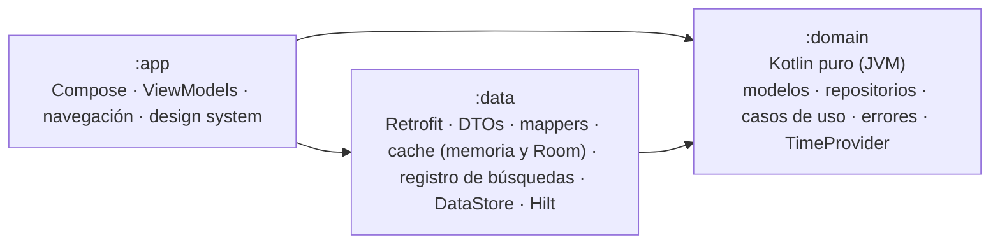

# BookSearch — buscador de libros (Android)

Prueba técnica Android: buscador de libros con **Jetpack Compose**, arquitectura **MVVM multimódulo**, **cancelación real** de búsquedas en curso, **cache en memoria con TTL** y tests en todas las capas.

> **Hito 1** implementado. El Hito 2 está listado al final y la arquitectura está preparada para él.

## Capturas

| Onboarding | Home | Buscando | Resultados recientes (cache) | Detalle | Ajustes |
|---|---|---|---|---|---|
| _pendiente_ | _pendiente_ | _pendiente_ | _pendiente_ | _pendiente_ | _pendiente_ |

<!-- Guardar las capturas en docs/screenshots/ y sustituir "_pendiente_" por  -->

## API elegida: Open Library

Uso [Open Library](https://openlibrary.org/developers/api) por tres motivos:

- **No requiere API key**: el proyecto se clona y se ejecuta sin configurar nada.
- **Catálogo muy amplio**, con portadas, autores, descripciones y temas.
- **Latencia real** (entre 0,5 s y varios segundos según el endpoint), que hace **visibles** la cancelación y el cache.

Antes de programar verifiqué todos los endpoints con `curl`. Estas son las diferencias respecto a lo previsto:

| Endpoint | Uso | Lo que hay que tener en cuenta |
|---|---|---|
| `/search.json?q=…&fields=…&limit=20` | Búsqueda | Pide solo los campos necesarios. Sin resultados devuelve `docs: []` → estado `Empty`. |
| `/trending/daily.json?fields=…` | Carrusel "Tendencias" | **Existe y es estable**, y acepta los mismos `fields` que la búsqueda, así que reutiliza el mismo DTO. No hizo falta la alternativa con Subjects. |
| `/subjects/{s}.json?limit=10` | Secciones de la home | Forma distinta a la búsqueda (`cover_id`, `authors[{name}]`), con DTO propio. Es el endpoint más lento. |
| `/works/{id}.json` | Detalle | `description` puede ser `String` u objeto `{type, value}` (lo resuelve `TextValueSerializer`). Los autores son referencias. `first_publish_date` es texto libre o **no existe**. |
| `/authors/{id}.json` | Nombres de autor | Se piden **en paralelo**. |
| `/search.json?q=key:/works/{id}` | Año del detalle | Muchas obras no tienen fecha en `/works`. El índice de búsqueda sí tiene el año, y se pide en paralelo con la obra. |
| `covers.openlibrary.org/b/id/{id}-M.jpg` / `-L.jpg` | Portadas | Si no hay portada, se muestra un placeholder. |

Todas las peticiones llevan el `User-Agent` que pide Open Library: `BookSearch/1.0 (+https://gitlab.com/android-apps9344722/book-search-engine-tht)`.

## Cómo ejecutar

Requisitos: Android SDK 36 y un JDK 17 o superior. Gradle viene con el wrapper.

```bash
./gradlew installDebug   # instala la app (debug) en un dispositivo o emulador
./gradlew test           # tests unitarios de todos los módulos
./gradlew build          # compila, ejecuta lint y tests
```

Para seguir el flujo de búsqueda y cache en Logcat:

```bash
adb logcat -s BookSearch okhttp.OkHttpClient
```

- **`BookSearch`**: decisiones de la app (acierto o fallo de cache y en qué backend, búsquedas canceladas o descartadas, latencia demo).
- **`okhttp.OkHttpClient`** (solo `debug`): todo el tráfico HTTP con la API. En Android Studio basta con filtrar Logcat por `tag:okhttp.OkHttpClient`. Por cada llamada se ve:

  ```
  --> GET https://openlibrary.org/search.json?q=tolkien&…      ← método y URL
  User-Agent: BookSearch/1.0 (…)                              ← cabeceras de la petición
  --> END GET
  <-- 200 https://openlibrary.org/search.json?q=tolkien&… (612ms)  ← status y tiempo
  content-type: application/json                              ← cabeceras de la respuesta
  {"numFound":…,"docs":[…]}                                   ← cuerpo JSON completo
  <-- END HTTP (612ms, 8431-byte body)
  ```

  Una llamada cancelada termina en `<-- HTTP FAILED: …`. Las respuestas largas se parten en varias líneas para no superar el límite de Logcat, y si hay peticiones en paralelo sus líneas se intercalan (el número de hilo de cada línea permite separarlas).

## Arquitectura

> Detalle de la estructura multimódulo y de las reglas de arquitectura en [ARCHITECTURE.md](ARCHITECTURE.md).

MVVM con separación estricta en tres módulos Gradle:



| Módulo | Contenido | Reglas |
|---|---|---|
| `:domain` | `Book`, `BookDetail`, `SearchResult(fromCache)`, `HomeContent`, `UserPreferences`; interfaces `BookRepository` y `PreferencesRepository`; `SearchBooksUseCase`, `GetBookDetailUseCase`, `GetHomeContentUseCase`; `DomainError` y `TimeProvider`. | Módulo `kotlin("jvm")`: **ninguna dependencia de Android**. |
| `:data` | `OpenLibraryApi`, DTOs, `TextValueSerializer`, mappers, `InMemoryCache`, cache en disco con Room (`RoomCache`, `BookCacheStore`), `SearchLog`, `BookRepositoryImpl`, `PreferencesRepositoryImpl` (DataStore), interceptores y módulos Hilt. | Los DTOs **nunca salen** de este módulo. Los nulls de la API se convierten aquí en valores por defecto o en tipos opcionales explícitos. |
| `:app` | Pantallas Compose, ViewModels, navegación type-safe y design system (`ui/theme`). | Cada pantalla expone **un único `StateFlow<UiState>`** inmutable y recibe las intenciones del usuario mediante funciones. |

Otras decisiones:

- **Inyección de dispatchers y configuración**: `@IoDispatcher`, `SearchConfig(debounceMillis)`, `CacheConfig(ttlMillis, maxEntries)` y `BuildInfo(isDebug)` se inyectan, así que los tests controlan el tiempo y el tipo de build.
- **Navegación type-safe** con rutas `@Serializable`. `DetailRoute(workId)` llega al `DetailViewModel` por **assisted injection** de Hilt, lo que permite testear el ViewModel sin `SavedStateHandle` ni Robolectric.
- **Preferencias sin caso de uso**: leer y guardar una preferencia no contiene lógica de negocio. Por simplicidad, los ViewModels de ajustes y onboarding usan directamente la interfaz de dominio `PreferencesRepository`. Los casos de uso se reservan para la lógica real (búsqueda, detalle y home).
- **Strings** en `strings.xml` desde el principio (base en español), incluidos plurales.

## Decisiones principales

### 1. Cancelación de búsquedas

Requisito: *si el usuario lanza una nueva búsqueda antes de que termine la anterior, la anterior se cancela y nunca se muestran sus resultados.*

**Elegí un `Job` gestionado en el ViewModel (`searchJob`) en lugar de `flatMapLatest`.** La búsqueda se dispara de cuatro maneras distintas: escribir, el botón "Cancelar", el botón de limpiar (X) y "Reintentar". Con un `Job`, cada intención es una función explícita que primero cancela el job anterior. Así, el botón "Cancelar" y el estado `Cancelled` se implementan en una línea, sin inyectar eventos sintéticos en un flujo de queries.

Funcionamiento:

1. Cada vez que cambia el texto, se normaliza la query (`trim`). Si queda vacía se ignora y se vuelve a la home. Si solo ha cambiado el espacio final, no se repite la búsqueda.
2. Se cancela el job anterior y el estado pasa **inmediatamente** a `Loading(query)`. Así nunca quedan en pantalla resultados de una query anterior.
3. El nuevo job ejecuta primero el **debounce** (`delay(300 ms)`) y después la búsqueda. Cancelar el job cancela el `delay` o la llamada suspendida de Retrofit y, con ella, **la petición de OkHttp**. En Logcat aparece `HTTP FAILED: Socket closed`.
4. Solo el resultado de la query que se está cargando puede sustituir el estado. Una coroutine cancelada no llega a ese punto, pero la comprobación deja la regla explícita.

Formas de cancelar una búsqueda:

| Acción | Resultado |
|---|---|
| Escribir otra búsqueda | Cancela la anterior automáticamente. |
| Botón **Cancelar** | Cancela y pasa a `Cancelled(query)`, o a la home si el campo está vacío. |
| Botón **X** | Cancela y vuelve a la home de descubrimiento. |
| Salir de la pantalla | `viewModelScope` cancela todo. |

**El debounce es corto (300 ms) a propósito.** Así una petición suele seguir en vuelo cuando llega la siguiente pulsación, y se ven **cancelaciones reales de red**, no solo descartes del debounce. Los logs distinguen los dos casos: `search cancelled: "x" in flight` frente a `search discarded during debounce`.

**Nunca se captura `CancellationException` como error:**

- No uso `runCatching` ni `catch (e: Exception)` genéricos alrededor de llamadas `suspend`.
- `safeApiCall` (en `:data`) relanza `CancellationException` antes de mapear errores. Además llama a `ensureActive()`, para que el `IOException("Canceled")` de OkHttp tras una cancelación no se convierta en un falso "sin conexión".
- Los ViewModels solo capturan `DomainException`.
- Las tolerancias a fallos parciales (secciones de la home, autores del detalle) usan `catchDomainError`, que solo captura `DomainException`.

Resultado: **ninguna cancelación aparece nunca como error en la UI.**

### 2. Cache

- `InMemoryCache<K, V>` genérico en `:data`, con **TTL de 3 minutos** (configurable por constructor) y un **límite LRU** de 50 entradas.
- **Clave**: la query normalizada (`trim().lowercase()`), de modo que "Tolkien " y "tolkien" comparten entrada.
- Cada entrada guarda el valor y el instante en que se guardó, obtenido de un **`TimeProvider` inyectado**. En los tests un `FakeTimeProvider` avanza el reloj, sin esperas reales.
- **Thread-safety con `Mutex`** en lugar de `ConcurrentHashMap`. Todas las operaciones son compuestas: `get` comprueba la expiración, puede borrar la entrada y actualiza el orden LRU (en un `LinkedHashMap` con `accessOrder` hasta las lecturas modifican la estructura), y `put` puede desalojar la entrada más antigua. Un único `Mutex` las hace atómicas y suspende la coroutine en lugar de bloquear el hilo.
- **Flujo en `BookRepositoryImpl`**: si hay cache válida se devuelve con `fromCache = true` y sin red. Si está caducada o no existe, se pide a la red, se guarda y se devuelve. **Si la red falla, no se guarda nada.**
- **En la UI**, cuando el resultado viene del cache aparece una etiqueta discreta **"Resultados recientes"**.
- El mismo mecanismo cachea la home (tendencias y secciones) y el detalle. El detalle solo se cachea si todos sus autores se resolvieron, para que un fallo puntual se reintente la próxima vez.
- **Por qué no un decorador `CachedBookRepository`**: el repositorio usa tres caches con políticas distintas (búsqueda con `fromCache`, home, y detalle solo si está completo). Mantenerlas junto a la lógica de red que protegen resultó más claro que repartirlas en un decorador.
- Limitación aceptada: dos búsquedas idénticas *simultáneas* sin cache harán dos peticiones. No ocurre en la UI, porque cada búsqueda nueva cancela la anterior.

### 2b. Cache en disco (Room), seleccionable en Ajustes

Además de la cache en memoria, existe una cache persistente en **Room**. El usuario elige el backend en *Ajustes → Caché*:

| Opción | Comportamiento |
|---|---|
| **Memoria** (por defecto) | `InMemoryCache`, como siempre. Se vacía al cerrar la app por completo. |
| **Disco (persistente)** | `RoomCache`: los resultados se guardan como JSON en una base de datos local y sobreviven a un reinicio completo de la app. El TTL de 3 minutos también aplica en disco (la fecha de guardado se persiste). |

Cómo está montado:

- `KeyValueCache<K, V>` (en `:data`) es la interfaz común; `InMemoryCache` y `RoomCache` la implementan, con el mismo TTL por entrada y el mismo límite de 50 entradas. La expiración se comprueba al leer, así que no hay limpieza en el arranque.
- **Al llegar al límite, la memoria desaloja por LRU y el disco por FIFO.** `InMemoryCache` desaloja la entrada usada hace más tiempo (un `get` la renueva). `RoomCache` desaloja la que se **guardó** hace más tiempo (`stored_at_millis`): leerla no la renueva. Es una decisión consciente. Para tener LRU en disco, `get` tendría que escribir en cada lectura y haría falta una columna de último acceso separada de `stored_at_millis`, porque esa columna también calcula el TTL y actualizarla alargaría la caducidad de la entrada. Con un TTL de 3 minutos y 50 entradas por `scope`, casi siempre caduca antes de llegar al límite, así que la diferencia apenas se nota.
- `BookCaches` agrupa las tres caches (búsqueda, home, detalle); `InMemoryBookCaches` y `RoomBookCaches` son los dos backends. `BookCacheStore` lee la preferencia (DataStore) en cada operación y entrega el backend activo: cambiar la opción en Ajustes afecta a la siguiente petición, sin reiniciar la app.
- El backend de disco guarda JSON con modelos propios de cache (`CachedBook`, `CachedBookDetail`, en `:data`) y sus mappers en `data/mapper/CacheMappers.kt`. Los modelos de dominio no son `@Serializable`: `:domain` no depende del formato de almacenamiento, y renombrar un campo del dominio no cambia lo guardado en disco. Si un valor guardado no se puede decodificar (por ejemplo, porque lo escribió una versión anterior con otro formato), se trata como si no estuviera en la cache y la app no crashea.
- **Solo los errores de formato se tratan como "no está en la cache".** `RoomBookCaches` decodifica con `decodeOrNull`, que solo captura `IllegalArgumentException`. Eso incluye `SerializationException` de kotlinx, que es una subclase suya y es lo que se lanza ante un JSON mal formado o con campos que faltan o tienen otro tipo. No se usa `runCatching`: ocultaría también `CancellationException` (regla 7 de [ARCHITECTURE](ARCHITECTURE.md)) y los bugs reales, que deben verse y no confundirse con "no estaba guardado".
- **Cambios de esquema: se borra la base de datos, sin migraciones.** La base de datos se crea con `fallbackToDestructiveMigration(dropAllTables = true)`. Sin esa opción, subir la `version` de `BookSearchDatabase` sin escribir una migración haría que Room lanzara `IllegalStateException` al abrirla y la app crashearía. Como solo guarda una cache que se puede volver a pedir a la red, borrarla y recrearla es más simple y seguro que mantener migraciones. Por eso `exportSchema` sigue a `false`: exportar el esquema solo sirve para probar migraciones, y aquí no las hay.
- Los dos backends son independientes: las entradas no se migran al cambiar de opción.
- La base de datos es `booksearch_cache.db`, una sola tabla `cache_entries` con clave compuesta `(scope, cache_key)`, donde `scope` separa búsqueda/home/detalle.

**Info estado.** Junto al título *Caché* de Ajustes, el botón *Info estado* abre un bottom sheet con las búsquedas **con resultados** guardadas en el backend activo y una cuenta atrás en tiempo real (`mm:ss`). Las ya caducadas no se borran de la lista: se muestran en gris con `0:00` y van al final, porque la expiración es perezosa y siguen guardadas hasta que esa búsqueda se vuelve a leer. El texto mostrado es la clave normalizada (sin espacios y en minúsculas). El `CacheStatusViewModel` vuelve a leer la cache cada segundo (`KeyValueCache.snapshot()`, que no altera el orden de desalojo) solo mientras el sheet está visible.

### 2c. Registro de peticiones / búsquedas

En *Ajustes → Peticiones / Búsquedas*, el botón *Info estado* abre un bottom sheet con las últimas búsquedas de la sesión, la más reciente arriba. Cada fila muestra el estado, el texto buscado y la hora. Al tocarla se despliega el detalle, como un `ExpandableListView` del sistema de vistas clásico, pero hecho en Compose (`LazyColumn` + `AnimatedVisibility`):

| Estado | Color | Detalle |
|---|---|---|
| **Éxito** | teal | Libros devueltos, duración y origen (red o caché). |
| **Cancelada** | naranja oscuro | Tiempo desde que empezó hasta que se canceló. |
| **Fallo** | rojo | Tipo de error (`HTTP 404`, sin conexión, tiempo agotado…) y duración. |

- **Dónde se registra**: `BookRepositoryImpl.searchBooks` envuelve cada búsqueda en `SearchLog.track`, que mide el tiempo con el `TimeProvider` y anota cómo terminó. Ahí ya se sabe todo: el número de libros, si vino de la caché y el `DomainError` ya traducido. Un interceptor de OkHttp no vería las búsquedas servidas desde la caché ni el número de libros.
- **Cancelaciones**: `track` captura `CancellationException` solo para anotarla y la **relanza** (regla 7 de [ARCHITECTURE](ARCHITECTURE.md)). Registrar nunca cambia cómo termina una búsqueda. Las búsquedas descartadas durante el debounce no aparecen, porque nunca empezaron.
- **Se incluyen las búsquedas servidas desde la caché**, marcadas con origen *Caché*, para que se vea la caché en acción.
- **En memoria**: se guardan las últimas 50 entradas y se pierden al cerrar la app, porque es una herramienta de diagnóstico de la sesión. El botón *Vaciar* las borra.
- **Colores**: `StatusColors` en `ui/theme`, con variante clara y oscura y contraste de al menos 4,5:1, iguales en las tres paletas. El color siempre va acompañado de la etiqueta escrita ("ÉXITO", "CANCELADA", "FALLO"), para no depender solo de él.
- **Simular un fallo (solo `debug`)**: Open Library no falla a demanda, así que una búsqueda cuyo texto contenga `getfail001` (en cualquier combinación de mayúsculas y minúsculas) recibe un **HTTP 404** de `SimulatedFailureInterceptor` (`data/src/debug`) sin llegar a la red. El fallo sigue el camino real: `HttpException` → `DomainError.Server(404)` → pantalla de error con *Reintentar* → fila roja en el registro. También aparece en Logcat (`okhttp.OkHttpClient`). En `release` el interceptor no existe y el sheet no menciona `getfail001`.

### 3. Manejo de errores

`safeApiCall` traduce los errores técnicos a `DomainError`, y la UI muestra un mensaje comprensible para cada tipo:

| Error técnico | `DomainError` |
|---|---|
| `IOException` | `NoConnection` |
| `SocketTimeoutException` / `InterruptedIOException` | `Timeout` |
| `HttpException` | `Server(code)` |
| JSON inválido u otro | `Unknown` |

Comportamiento por pantalla:

- **Búsqueda**: muestra `Error(query, tipo)` con el botón **Reintentar**.
- **Home**: tolera fallos parciales. Una sección que falla simplemente no se muestra, y solo si fallan todas aparece el error.
- **Detalle**: carga los autores en paralelo (`coroutineScope` + `async`/`awaitAll`). Si falla un autor se muestran los demás, y el año se obtiene del índice de búsqueda si la obra no lo trae.

### 4. Modo demo de latencia (solo `debug`)

Es una herramienta para demostrar la cancelación aunque Open Library responda rápido.

- `DemoLatencyInterceptor` vive en `data/src/debug` y añade **1,5 s** antes de cada petición a la API. **Está desactivado por defecto** y se activa en *Ajustes → Herramientas de demostración*.
- La espera se hace por tramos cortos y comprueba si OkHttp canceló la llamada. Así, una búsqueda cancelada **ni siquiera llega a la red** (`demo latency: call cancelled before reaching the network`).
- En `release` el interceptor no se compila (multibinding vacío) y la opción no aparece en Ajustes.
- **Logging HTTP** (`HttpLogging.kt`, también en `data/src/debug`): un `HttpLoggingInterceptor` a nivel `BODY` que escribe en la etiqueta `okhttp.OkHttpClient`, la misma que usa OkHttp en Android, a través de Timber. Va después de la latencia demo, así que una petición se registra cuando sale de verdad. Como es un interceptor de aplicación, no muestra las cabeceras que OkHttp añade después (`Host`, `Accept-Encoding`…). En `release` no existe.
- Las portadas usan un cliente OkHttp aparte, con el mismo `User-Agent` pero sin herramientas de debug, para no llenar Logcat con imágenes.

### 5. Diseño

- **Design system** propio en `ui/theme`: 3 paletas con variante clara y oscura, tipografía Material 3 completa, *shapes* y tokens de espaciado y de tamaño de portada.
  - **Biblioteca** (por defecto): azul tinta y ámbar.
  - **Bosque**: verde pino y terracota.
  - **Grafito**: carbón e índigo.
- **Tipografía Nunito Sans** (licencia SIL OFL), incluida en `res/font`. No uso el proveedor de *downloadable fonts* para no depender de Google Play Services. Licencia en [`licenses/OFL-NunitoSans.txt`](licenses/OFL-NunitoSans.txt).
- **Splash** con la API `core-splashscreen`. Se mantiene hasta leer las preferencias, para no mostrar un tema o una pantalla incorrectos.
- **Accesibilidad mínima**: `contentDescription` en portadas e iconos, áreas táctiles de al menos 48 dp, encabezados marcados con `heading()`, `liveRegion` en el texto "Buscando…" y semántica de radio y switch en Ajustes.

## Tests

```bash
./gradlew test
```

| Módulo | Qué cubre |
|---|---|
| `:domain` (MockK) | `SearchBooksUseCase`: delega, normaliza, ignora queries vacías y propaga errores. `GetBookDetailUseCase`: delega y propaga. `GetHomeContentUseCase`: carga en paralelo y tolera fallos parciales. |
| `:data` (`FakeTimeProvider`, `FakeOpenLibraryApi` que cuenta llamadas y Robolectric para Room) | **Cache**: primera búsqueda va a red; misma query dentro del TTL sin red y con `fromCache = true`; "Tolkien " y "tolkien" comparten entrada; tras el TTL vuelve a red y actualiza; un error de red no se cachea; queries distintas tienen entradas independientes; desalojo LRU en memoria; escrituras concurrentes desde varios hilos. **Cache en disco (Room)**: seleccionada la opción "Disco", segunda búsqueda sin red y con `fromCache = true`; tras el TTL vuelve a red; un fallo de SQLite se trata como "no está en la cache" y la app no crashea; un JSON que ya no encaja o no es válido también. **Room real** (`CacheEntryDaoTest`, `RoomCacheIntegrationTest`, sobre SQLite en memoria con Robolectric): la clave compuesta (mismo `cache_key` en dos `scope`), `upsert` reemplaza, `getAll`/`count` por `scope`, `deleteOldest` borra por `stored_at_millis` y solo en su `scope`, y en `RoomCache` el límite de entradas (FIFO: leer una entrada no la libra del desalojo) y el TTL. **Registro de búsquedas** (`SearchLogTest`): éxito con número de libros, origen y duración; un fallo se anota y se relanza el mismo error; una cancelación se anota con su tiempo y se sigue propagando; solo se guardan las 50 últimas, la más reciente primero; *Vaciar*. El repositorio registra búsquedas de red, de la caché y fallidas. `getfail001` devuelve 404 en cualquier combinación de mayúsculas y minúsculas, y solo en búsquedas. **Serialización y mappers**: `description` como string y como objeto, campos ausentes con valores por defecto. **Errores**: mapeo a `DomainError` y `CancellationException` siempre relanzada. **Detalle**: autores en paralelo con fallo parcial y año desde el índice de búsqueda. |
| `:app` (`runTest`, `StandardTestDispatcher`, `MainDispatcherRule`, Turbine) | Una nueva búsqueda cancela la anterior y **solo** se emiten resultados de la última (latencia simulada con `delay` y `advanceTimeBy`). El debounce agrupa pulsaciones. Botón Cancelar → `Cancelled`. X → vuelta a la home. Lista vacía → `Empty`. Error → `Error`, y Reintentar relanza. Resultado cacheado → `Success(fromCache = true)`. También el detalle y los ajustes, y el registro de búsquedas: se muestra, se actualiza en vivo y se vacía. La pista de `getfail001` solo aparece en `debug`. |

Robolectric simula el framework de Android en la JVM, así que estos tests corren con `./gradlew test`, sin emulador. Se usa solo donde hace falta Android de verdad: el SQL que genera Room y las dos clases de tests que crean `SQLiteException` para simular fallos de disco. El resto de tests de `:data` son JUnit puro.

Los nombres de test están en inglés y siguen el formato *given / when / then*.

## Stack y versiones

Kotlin 2.4.21 · AGP 9.5.1 (Kotlin integrado) · Gradle 9.9.1 · `compileSdk`/`targetSdk` 36 · `minSdk` 26 · Compose BOM 2026.06.01 (Material 3) · Hilt 2.60.1 · Retrofit 3.0.0 · OkHttp 5.4.0 · kotlinx.serialization 1.13.0 · Coroutines 1.11.0 · Navigation Compose 2.9.8 · Lifecycle 2.10.0 · DataStore 1.3.0 · Coil 3.5.0 · Timber 5.0.1 · Room 2.8.5 · JUnit 4 · MockK · Turbine · Robolectric 4.18.1.

Todas las versiones están en [`gradle/libs.versions.toml`](gradle/libs.versions.toml).

Nota sobre `compileSdk 36`: las últimas versiones de Compose (1.12), core-ktx (1.19), Navigation (2.10), Lifecycle (2.11), OkHttp (5.5) y Coil (3.6) exigen `compileSdk 37`. Como el requisito es SDK 36, se fijó en cada caso **la última versión estable compatible con 36**.

## Limitaciones conocidas

- **La home espera a todas sus secciones** antes de mostrarse. El endpoint de *subjects* de Open Library puede tardar varios segundos, así que la primera carga puede ser lenta; las siguientes salen del cache. Mostrar cada sección según llega sería una mejora sencilla para el Hito 2.
- Las descripciones de Open Library pueden traer Markdown. Se limpian las notas finales (`----`), pero el Markdown no se renderiza.

## Fuera de alcance (Hito 2)

La arquitectura está preparada, pero esto no está implementado:

- **Login**.
- **Selector de idioma inglés/español**: los textos ya están en `strings.xml`, solo falta `values-en` y el selector.
- **Loading personalizado o animado**.
- **Accesibilidad completa**: TalkBack revisado, tamaños de fuente dinámicos y contraste.
- **Responsividad completa**: tablets, plegables y landscape con layouts adaptativos.
- **Favoritos con Firestore**: encajaría como un nuevo repositorio en `:domain`/`:data`.

## Glosario

Términos técnicos que aparecen en este README y en [ARCHITECTURE.md](ARCHITECTURE.md), en orden alfabético.

| Término | Qué significa | En este proyecto |
|---|---|---|
| **AGP** (Android Gradle Plugin) | Plugin de Gradle que sabe compilar y empaquetar apps y librerías Android. | Versión 9.5.1, con Kotlin integrado. |
| **API** (Application Programming Interface) | Conjunto de operaciones que un sistema expone para que otro lo use. | La API REST de Open Library. |
| **API key** | Clave secreta que algunas APIs exigen para identificar a quien llama. | Open Library no la pide, así que no hay nada que configurar. |
| **Assisted injection** | Variante de la inyección de dependencias en la que parte de los parámetros los da quien crea el objeto y el resto los aporta el contenedor. | `DetailViewModel` recibe el `workId` así, sin `SavedStateHandle`. |
| **Backend (de cache)** | Implementación concreta que guarda los datos detrás de una interfaz común. | Memoria (`InMemoryBookCaches`) o disco (`RoomBookCaches`). |
| **Bottom sheet** | Panel que sube desde la parte inferior de la pantalla. | La hoja *Info estado* de Ajustes. |
| **Build type** (`debug` / `release`) | Variantes de compilación de la misma app: `debug` para desarrollo, `release` para publicar. | Las herramientas de demo y el logging HTTP solo existen en `debug`. |
| **Cache** | Copia temporal de datos ya obtenidos para no volver a pedirlos. | Búsquedas, home y detalle, en memoria o en disco. |
| **Caso de uso** (use case) | Clase de `:domain` que encapsula una operación de negocio. | `SearchBooksUseCase`, `GetBookDetailUseCase`, `GetHomeContentUseCase`. |
| **`CancellationException`** | Excepción con la que Kotlin señala que una coroutine fue cancelada. No es un error y no debe capturarse como tal. | Siempre se relanza (regla 7 de ARCHITECTURE). |
| **Clave compuesta** | Clave primaria formada por varias columnas a la vez. | `(scope, cache_key)` en la tabla `cache_entries`. |
| **Coil** | Librería de carga de imágenes para Compose. | Carga las portadas. |
| **Coroutine** | Unidad de trabajo asíncrono de Kotlin: puede suspenderse sin bloquear un hilo y cancelarse. | Toda la red, la cache y los ViewModels. |
| **DAO** (Data Access Object) | Interfaz con las consultas a la base de datos; Room genera su implementación. | `CacheEntryDao`. |
| **DataStore** | Almacén de preferencias clave-valor de AndroidX, asíncrono (sustituye a `SharedPreferences`). | Tema, backend de cache, onboarding, modo demo. |
| **Debounce** | Esperar a que el usuario deje de teclear un momento antes de actuar. | 300 ms antes de lanzar la búsqueda. |
| **Decorador** | Patrón que envuelve un objeto con otro de la misma interfaz para añadir comportamiento. | Se descartó un `CachedBookRepository` decorador (ver *2. Cache*). |
| **Design system** | Conjunto de colores, tipografía, formas y medidas que comparte toda la UI. | `ui/theme`, con tres paletas. |
| **DI** (Dependency Injection) | Que un objeto reciba sus dependencias desde fuera en lugar de crearlas. | Con Hilt. |
| **Dispatcher** | Decide en qué hilo o grupo de hilos se ejecuta una coroutine. | `@IoDispatcher` inyectado; en tests, `StandardTestDispatcher`. |
| **dp** (density-independent pixel) | Unidad de medida de Android que se ve del mismo tamaño en pantallas de distinta densidad. | Áreas táctiles de al menos 48 dp. |
| **DTO** (Data Transfer Object) | Clase que refleja exactamente el JSON de la API, sin lógica. | Viven en `:data` y nunca salen de ese módulo. |
| **Endpoint** | Cada URL concreta de una API. | `/search.json`, `/works/{id}.json`… |
| **Entidad** (`@Entity`) | Clase que Room convierte en una tabla. | `CacheEntryEntity` → tabla `cache_entries`. |
| **Esquema / migración** | El esquema es la estructura de las tablas; una migración transforma un esquema antiguo en el nuevo sin perder datos. | No hay migraciones: ante un cambio de esquema la base de datos se recrea. |
| **Expiración perezosa** (lazy) | Una entrada caducada no se borra cuando caduca, sino la próxima vez que alguien la lee. | Las dos caches. |
| **ExpandableListView** | Lista del sistema de vistas clásico (XML) cuyas filas se despliegan para mostrar su detalle. Compose no tiene un equivalente directo. | El registro de búsquedas reproduce ese comportamiento con `LazyColumn` + `AnimatedVisibility`. |
| **Fake** | Implementación simplificada y real de una interfaz, usada en tests en lugar de un mock. | `FakeTimeProvider`, `FakeOpenLibraryApi`, `FakeCacheEntryDao`. |
| **FIFO** (First In, First Out) | Política de desalojo: sale primero lo que entró primero, aunque se haya usado hace poco. | La cache en disco. |
| **`flatMapLatest`** | Operador de `Flow` que cancela el trabajo anterior cuando llega un valor nuevo. | Se descartó a favor de un `Job` explícito. |
| **Flow / `StateFlow`** | Flujo asíncrono de valores de Kotlin. `StateFlow` siempre tiene un valor actual y emite sus cambios. | Cada pantalla expone un `StateFlow<UiState>`. |
| **Given / when / then** | Forma de escribir un test: estado inicial, acción y resultado esperado. | Formato de todos los nombres de test. |
| **Gradle** | Herramienta de build del proyecto; el *wrapper* (`./gradlew`) descarga la versión correcta. | Proyecto multimódulo con catálogo de versiones. |
| **Hilt** | Librería de inyección de dependencias para Android, basada en Dagger. | Monta el grafo de toda la app. |
| **Hito** | Entrega parcial de la prueba técnica. | Hito 1 implementado; Hito 2 fuera de alcance. |
| **Interceptor** | Pieza de OkHttp que ve y puede modificar cada petición y respuesta. | `User-Agent`, logging, `DemoLatencyInterceptor` y `SimulatedFailureInterceptor`. |
| **Job** | Referencia a una coroutine en marcha que permite cancelarla. | `searchJob` en el ViewModel de búsqueda. |
| **JSON** | Formato de texto para datos estructurados. | Respuestas de la API y valores guardados en la cache en disco. |
| **Jetpack Compose** | Toolkit declarativo de Android para construir la UI en Kotlin. | Todas las pantallas. |
| **JVM** (Java Virtual Machine) | Máquina virtual donde se ejecuta Kotlin fuera de Android. | `:domain` es Kotlin puro de JVM; los tests unitarios corren en la JVM. |
| **kotlinx.serialization** | Librería oficial de Kotlin para convertir objetos a JSON y al revés. | DTOs, cache en disco y rutas de navegación. |
| **Lint** | Análisis estático que detecta errores y malas prácticas sin ejecutar el código. | Forma parte de `./gradlew build`. |
| **Logcat** | Visor de logs de Android. | `adb logcat -s BookSearch okhttp.OkHttpClient`. |
| **LRU** (Least Recently Used) | Política de desalojo: sale lo que lleva más tiempo sin usarse; leer una entrada la renueva. | La cache en memoria. |
| **Mapper** | Función que convierte un modelo en otro (DTO → dominio, dominio → cache). | `data/mapper/`. |
| **Material 3** | Sistema de diseño de Google y su librería de componentes para Compose. | Base de la UI y la tipografía. |
| **Mock / MockK** | Un mock es un objeto de test cuyo comportamiento se programa y se verifica; MockK es la librería de mocks para Kotlin. | Tests de `:domain`. |
| **Módulo Gradle** | Subproyecto que se compila por separado y declara de qué otros depende. | `:app`, `:data`, `:domain`. |
| **Multibinding** | Función de Hilt/Dagger para inyectar un conjunto de implementaciones aportadas por varios módulos. | Lista de interceptores; vacía en `release`. |
| **MVVM** (Model-View-ViewModel) | Arquitectura que separa la UI (View), su estado y lógica de presentación (ViewModel) y los datos (Model). | Arquitectura de la app. |
| **Mutex** | Cerrojo que deja pasar a una sola coroutine a la vez por una sección de código. | Protege `InMemoryCache` y `RoomCache`. |
| **OkHttp** | Cliente HTTP sobre el que funciona Retrofit. | Peticiones, interceptores y cancelación real. |
| **Placeholder** | Imagen o contenido provisional que se muestra cuando falta el real. | Libros sin portada. |
| **Repositorio** | Clase que oculta de dónde vienen los datos (red, cache…) tras una interfaz de dominio. | `BookRepository` / `BookRepositoryImpl`. |
| **REST** | Estilo de API web basado en URLs y métodos HTTP. | Open Library. |
| **Retrofit** | Librería que convierte una interfaz Kotlin en llamadas HTTP. | `OpenLibraryApi`. |
| **Robolectric** | Simula el framework de Android en la JVM para ejecutar tests sin emulador. | Tests de Room y de `SQLiteException`. |
| **Room** | Librería de AndroidX sobre SQLite: genera el SQL y el código de acceso a partir de anotaciones. | Cache en disco (`BookSearchDatabase`). |
| **Scope (de cache)** | Columna que separa en la misma tabla los distintos tipos de cache. | `search`, `home`, `detail`. |
| **SDK** (`compileSdk`, `minSdk`, `targetSdk`) | Versión de Android con la que se compila, la mínima en la que se instala y aquella para la que se ha probado. | 36 / 26 / 36. |
| **SQLite** | Base de datos SQL embebida en un único fichero, incluida en Android. | Debajo de Room. |
| **Splash** | Pantalla que se muestra mientras arranca la app. | `core-splashscreen`, hasta leer las preferencias. |
| **Stub** | Implementación vacía que solo sirve para compilar. En los tests unitarios, el `android.jar` son stubs que lanzan excepción. | Motivo para usar Robolectric. |
| **Thread-safety** | Que el código funcione bien aunque varios hilos lo usen a la vez. | Las caches, mediante `Mutex`. |
| **Timber** | Librería de logging para Android. | Logs con la etiqueta `BookSearch`. |
| **TTL** (Time To Live) | Tiempo que una entrada sigue siendo válida antes de caducar. | 3 minutos en las dos caches. |
| **Turbine** | Librería para testear `Flow` cómodamente. | Tests de ViewModels. |
| **Type-safe navigation** | Navegación con rutas definidas como clases Kotlin en lugar de strings, comprobadas al compilar. | `DetailRoute(workId)`. |
| **UiState** | Clase inmutable que describe todo lo que muestra una pantalla en un momento dado. | `Loading`, `Success`, `Error`, `Cancelled`, `Empty`… |
| **Upsert** | Insertar o, si ya existe la clave, reemplazar. | `CacheEntryDao.upsert`. |
| **User-Agent** | Cabecera HTTP que identifica a la app que hace la petición. | Open Library la pide. |
| **ViewModel** | Clase de AndroidX que guarda el estado de una pantalla y sobrevive a giros de pantalla. | Uno por pantalla; `viewModelScope` cancela su trabajo al salir. |
