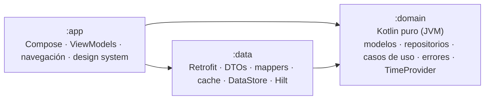

# BookSearch — buscador de libros (Android)

Prueba técnica Android: buscador de libros con **Jetpack Compose**, arquitectura **MVVM multimódulo**, **cancelación real** de búsquedas en curso, **cache en memoria con TTL** y tests en todas las capas.

> **Hito 1** implementado. El Hito 2 está listado al final y la arquitectura está preparada para él.

## Capturas

| Onboarding | Home | Buscando | Resultados recientes (cache) | Detalle | Ajustes |
|---|---|---|---|---|---|
| _pendiente_ | _pendiente_ | _pendiente_ | _pendiente_ | _pendiente_ | _pendiente_ |

<!-- Guardar las capturas en docs/screenshots/ y sustituir "_pendiente_" por  -->

## API elegida: Open Library

Uso [Open Library](https://openlibrary.org/developers/api) por tres motivos:

- **No requiere API key**: el proyecto se clona y se ejecuta sin configurar nada.
- **Catálogo muy amplio**, con portadas, autores, descripciones y temas.
- **Latencia real** (entre 0,5 s y varios segundos según el endpoint), que hace **visibles** la cancelación y el cache.

Antes de programar verifiqué todos los endpoints con `curl`. Estas son las diferencias respecto a lo previsto:

| Endpoint | Uso | Lo que hay que tener en cuenta |
|---|---|---|
| `/search.json?q=…&fields=…&limit=20` | Búsqueda | Pide solo los campos necesarios. Sin resultados devuelve `docs: []` → estado `Empty`. |
| `/trending/daily.json?fields=…` | Carrusel "Tendencias" | **Existe y es estable**, y acepta los mismos `fields` que la búsqueda, así que reutiliza el mismo DTO. No hizo falta la alternativa con Subjects. |
| `/subjects/{s}.json?limit=10` | Secciones de la home | Forma distinta a la búsqueda (`cover_id`, `authors[{name}]`), con DTO propio. Es el endpoint más lento. |
| `/works/{id}.json` | Detalle | `description` puede ser `String` u objeto `{type, value}` (lo resuelve `TextValueSerializer`). Los autores son referencias. `first_publish_date` es texto libre o **no existe**. |
| `/authors/{id}.json` | Nombres de autor | Se piden **en paralelo**. |
| `/search.json?q=key:/works/{id}` | Año del detalle | Muchas obras no tienen fecha en `/works`. El índice de búsqueda sí tiene el año, y se pide en paralelo con la obra. |
| `covers.openlibrary.org/b/id/{id}-M.jpg` / `-L.jpg` | Portadas | Si no hay portada, se muestra un placeholder. |

Todas las peticiones llevan el `User-Agent` que pide Open Library: `BookSearch/1.0 (+https://gitlab.com/android-apps9344722/book-search-engine-tht)`.

## Cómo ejecutar

Requisitos: Android SDK 36 y un JDK 17 o superior. Gradle viene con el wrapper.

```bash
./gradlew installDebug   # instala la app (debug) en un dispositivo o emulador
./gradlew test           # tests unitarios de todos los módulos
./gradlew build          # compila, ejecuta lint y tests
```

Para seguir el flujo de búsqueda y cache en Logcat:

```bash
adb logcat -s BookSearch OkHttp
```

## Arquitectura

> Detalle de la estructura multimódulo y de las reglas de arquitectura en [ARCHITECTURE.md](ARCHITECTURE.md).

MVVM con separación estricta en tres módulos Gradle:



| Módulo | Contenido | Reglas |
|---|---|---|
| `:domain` | `Book`, `BookDetail`, `SearchResult(fromCache)`, `HomeContent`, `UserPreferences`; interfaces `BookRepository` y `PreferencesRepository`; `SearchBooksUseCase`, `GetBookDetailUseCase`, `GetHomeContentUseCase`; `DomainError` y `TimeProvider`. | Módulo `kotlin("jvm")`: **ninguna dependencia de Android**. |
| `:data` | `OpenLibraryApi`, DTOs, `TextValueSerializer`, mappers, `InMemoryCache`, `BookRepositoryImpl`, `PreferencesRepositoryImpl` (DataStore), interceptores y módulos Hilt. | Los DTOs **nunca salen** de este módulo. Los nulls de la API se convierten aquí en valores por defecto o en tipos opcionales explícitos. |
| `:app` | Pantallas Compose, ViewModels, navegación type-safe y design system (`ui/theme`). | Cada pantalla expone **un único `StateFlow<UiState>`** inmutable y recibe las intenciones del usuario mediante funciones. |

Otras decisiones:

- **Inyección de dispatchers y configuración**: `@IoDispatcher`, `SearchConfig(debounceMillis)`, `CacheConfig(ttlMillis, maxEntries)` y `BuildInfo(isDebug)` se inyectan, así que los tests controlan el tiempo y el tipo de build.
- **Navegación type-safe** con rutas `@Serializable`. `DetailRoute(workId)` llega al `DetailViewModel` por **assisted injection** de Hilt, lo que permite testear el ViewModel sin `SavedStateHandle` ni Robolectric.
- **Preferencias sin caso de uso**: leer y guardar una preferencia no contiene lógica de negocio. Por simplicidad, los ViewModels de ajustes y onboarding usan directamente la interfaz de dominio `PreferencesRepository`. Los casos de uso se reservan para la lógica real (búsqueda, detalle y home).
- **Strings** en `strings.xml` desde el principio (base en español), incluidos plurales.

## Decisiones principales

### 1. Cancelación de búsquedas

Requisito: *si el usuario lanza una nueva búsqueda antes de que termine la anterior, la anterior se cancela y nunca se muestran sus resultados.*

**Elegí un `Job` gestionado en el ViewModel (`searchJob`) en lugar de `flatMapLatest`.** La búsqueda se dispara de cuatro maneras distintas: escribir, el botón "Cancelar", el botón de limpiar (X) y "Reintentar". Con un `Job`, cada intención es una función explícita que primero cancela el job anterior. Así, el botón "Cancelar" y el estado `Cancelled` se implementan en una línea, sin inyectar eventos sintéticos en un flujo de queries.

Funcionamiento:

1. Cada vez que cambia el texto, se normaliza la query (`trim`). Si queda vacía se ignora y se vuelve a la home. Si solo ha cambiado el espacio final, no se repite la búsqueda.
2. Se cancela el job anterior y el estado pasa **inmediatamente** a `Loading(query)`. Así nunca quedan en pantalla resultados de una query anterior.
3. El nuevo job ejecuta primero el **debounce** (`delay(300 ms)`) y después la búsqueda. Cancelar el job cancela el `delay` o la llamada suspendida de Retrofit y, con ella, **la petición de OkHttp**. En Logcat aparece `HTTP FAILED: Socket closed`.
4. Solo el resultado de la query que se está cargando puede sustituir el estado. Una coroutine cancelada no llega a ese punto, pero la comprobación deja la regla explícita.

Formas de cancelar una búsqueda:

| Acción | Resultado |
|---|---|
| Escribir otra búsqueda | Cancela la anterior automáticamente. |
| Botón **Cancelar** | Cancela y pasa a `Cancelled(query)`, o a la home si el campo está vacío. |
| Botón **X** | Cancela y vuelve a la home de descubrimiento. |
| Salir de la pantalla | `viewModelScope` cancela todo. |

**El debounce es corto (300 ms) a propósito.** Así una petición suele seguir en vuelo cuando llega la siguiente pulsación, y se ven **cancelaciones reales de red**, no solo descartes del debounce. Los logs distinguen los dos casos: `search cancelled: "x" in flight` frente a `search discarded during debounce`.

**Nunca se captura `CancellationException` como error:**

- No uso `runCatching` ni `catch (e: Exception)` genéricos alrededor de llamadas `suspend`.
- `safeApiCall` (en `:data`) relanza `CancellationException` antes de mapear errores. Además llama a `ensureActive()`, para que el `IOException("Canceled")` de OkHttp tras una cancelación no se convierta en un falso "sin conexión".
- Los ViewModels solo capturan `DomainException`.
- Las tolerancias a fallos parciales (secciones de la home, autores del detalle) usan `catchDomainError`, que solo captura `DomainException`.

Resultado: **ninguna cancelación aparece nunca como error en la UI.**

### 2. Cache

- `InMemoryCache<K, V>` genérico en `:data`, con **TTL de 3 minutos** (configurable por constructor) y un **límite LRU** de 50 entradas.
- **Clave**: la query normalizada (`trim().lowercase()`), de modo que "Tolkien " y "tolkien" comparten entrada.
- Cada entrada guarda el valor y el instante en que se guardó, obtenido de un **`TimeProvider` inyectado**. En los tests un `FakeTimeProvider` avanza el reloj, sin esperas reales.
- **Thread-safety con `Mutex`** en lugar de `ConcurrentHashMap`. Todas las operaciones son compuestas: `get` comprueba la expiración, puede borrar la entrada y actualiza el orden LRU (en un `LinkedHashMap` con `accessOrder` hasta las lecturas modifican la estructura), y `put` puede desalojar la entrada más antigua. Un único `Mutex` las hace atómicas y suspende la coroutine en lugar de bloquear el hilo.
- **Flujo en `BookRepositoryImpl`**: si hay cache válida se devuelve con `fromCache = true` y sin red. Si está caducada o no existe, se pide a la red, se guarda y se devuelve. **Si la red falla, no se guarda nada.**
- **En la UI**, cuando el resultado viene del cache aparece una etiqueta discreta **"Resultados recientes"**.
- El mismo mecanismo cachea la home (tendencias y secciones) y el detalle. El detalle solo se cachea si todos sus autores se resolvieron, para que un fallo puntual se reintente la próxima vez.
- **Por qué no un decorador `CachedBookRepository`**: el repositorio usa tres caches con políticas distintas (búsqueda con `fromCache`, home, y detalle solo si está completo). Mantenerlas junto a la lógica de red que protegen resultó más claro que repartirlas en un decorador.
- Limitación aceptada: dos búsquedas idénticas *simultáneas* sin cache harán dos peticiones. No ocurre en la UI, porque cada búsqueda nueva cancela la anterior.

### 2b. Cache en disco (Room), seleccionable en Ajustes

Además de la cache en memoria, existe una cache persistente en **Room**. El usuario elige el backend en *Ajustes → Caché*:

| Opción | Comportamiento |
|---|---|
| **Memoria** (por defecto) | `InMemoryCache`, como siempre. Se vacía al cerrar la app por completo. |
| **Disco (persistente)** | `RoomCache`: los resultados se guardan como JSON en una base de datos local y sobreviven a un reinicio completo de la app. El TTL de 3 minutos también aplica en disco (la fecha de guardado se persiste). |

Cómo está montado:

- `KeyValueCache<K, V>` (en `:data`) es la interfaz común; `InMemoryCache` y `RoomCache` la implementan, con la misma política: TTL por entrada y límite LRU de 50 entradas. La expiración se comprueba al leer, así que no hay limpieza en el arranque.
- `BookCaches` agrupa las tres caches (búsqueda, home, detalle); `InMemoryBookCaches` y `RoomBookCaches` son los dos backends. `BookCacheStore` lee la preferencia (DataStore) en cada operación y entrega el backend activo: cambiar la opción en Ajustes afecta a la siguiente petición, sin reiniciar la app.
- Los modelos `Book` y `BookDetail` son `@Serializable`: el backend de disco guarda JSON, y un valor que no se pueda decodificar se trata como ausente (no crashea).
- Los dos backends son independientes: las entradas no se migran al cambiar de opción.
- La base de datos es `booksearch_cache.db`, una sola tabla `cache_entries` con clave compuesta `(scope, cache_key)`, donde `scope` separa búsqueda/home/detalle.

**Info estado.** Junto al título *Caché* de Ajustes, el botón *Info estado* abre un bottom sheet con las búsquedas **con resultados** guardadas en el backend activo y una cuenta atrás en tiempo real (`mm:ss`). Las ya caducadas no se borran de la lista: se muestran en gris con `0:00` y van al final, porque la expiración es perezosa y siguen guardadas hasta que esa búsqueda se vuelve a leer. El texto mostrado es la clave normalizada (sin espacios y en minúsculas). El `CacheStatusViewModel` vuelve a leer la cache cada segundo (`KeyValueCache.snapshot()`, que no altera el orden LRU) solo mientras el sheet está visible.

### 3. Manejo de errores

`safeApiCall` traduce los errores técnicos a `DomainError`, y la UI muestra un mensaje comprensible para cada tipo:

| Error técnico | `DomainError` |
|---|---|
| `IOException` | `NoConnection` |
| `SocketTimeoutException` / `InterruptedIOException` | `Timeout` |
| `HttpException` | `Server(code)` |
| JSON inválido u otro | `Unknown` |

Comportamiento por pantalla:

- **Búsqueda**: muestra `Error(query, tipo)` con el botón **Reintentar**.
- **Home**: tolera fallos parciales. Una sección que falla simplemente no se muestra, y solo si fallan todas aparece el error.
- **Detalle**: carga los autores en paralelo (`coroutineScope` + `async`/`awaitAll`). Si falla un autor se muestran los demás, y el año se obtiene del índice de búsqueda si la obra no lo trae.

### 4. Modo demo de latencia (solo `debug`)

Es una herramienta para demostrar la cancelación aunque Open Library responda rápido.

- `DemoLatencyInterceptor` vive en `data/src/debug` y añade **1,5 s** antes de cada petición a la API. **Está desactivado por defecto** y se activa en *Ajustes → Herramientas de demostración*.
- La espera se hace por tramos cortos y comprueba si OkHttp canceló la llamada. Así, una búsqueda cancelada **ni siquiera llega a la red** (`demo latency: call cancelled before reaching the network`).
- En `release` el interceptor no se compila (multibinding vacío) y la opción no aparece en Ajustes.
- Las portadas usan un cliente OkHttp aparte, con el mismo `User-Agent` pero sin herramientas de debug.

### 5. Diseño

- **Design system** propio en `ui/theme`: 3 paletas con variante clara y oscura, tipografía Material 3 completa, *shapes* y tokens de espaciado y de tamaño de portada.
  - **Biblioteca** (por defecto): azul tinta y ámbar.
  - **Bosque**: verde pino y terracota.
  - **Grafito**: carbón e índigo.
- **Tipografía Nunito Sans** (licencia SIL OFL), incluida en `res/font`. No uso el proveedor de *downloadable fonts* para no depender de Google Play Services. Licencia en [`licenses/OFL-NunitoSans.txt`](licenses/OFL-NunitoSans.txt).
- **Splash** con la API `core-splashscreen`. Se mantiene hasta leer las preferencias, para no mostrar un tema o una pantalla incorrectos.
- **Accesibilidad mínima**: `contentDescription` en portadas e iconos, áreas táctiles de al menos 48 dp, encabezados marcados con `heading()`, `liveRegion` en el texto "Buscando…" y semántica de radio y switch en Ajustes.

## Tests

```bash
./gradlew test
```

| Módulo | Qué cubre |
|---|---|
| `:domain` (MockK) | `SearchBooksUseCase`: delega, normaliza, ignora queries vacías y propaga errores. `GetBookDetailUseCase`: delega y propaga. `GetHomeContentUseCase`: carga en paralelo y tolera fallos parciales. |
| `:data` (`FakeTimeProvider` y `FakeOpenLibraryApi` que cuenta llamadas) | **Cache**: primera búsqueda va a red; misma query dentro del TTL sin red y con `fromCache = true`; "Tolkien " y "tolkien" comparten entrada; tras el TTL vuelve a red y actualiza; un error de red no se cachea; queries distintas tienen entradas independientes; desalojo LRU; escrituras concurrentes desde varios hilos. **Cache en disco (Room)**: seleccionada la opción "Disco", segunda búsqueda sin red y con `fromCache = true`; tras el TTL vuelve a red. **Serialización y mappers**: `description` como string y como objeto, campos ausentes con valores por defecto. **Errores**: mapeo a `DomainError` y `CancellationException` siempre relanzada. **Detalle**: autores en paralelo con fallo parcial y año desde el índice de búsqueda. |
| `:app` (`runTest`, `StandardTestDispatcher`, `MainDispatcherRule`, Turbine) | Una nueva búsqueda cancela la anterior y **solo** se emiten resultados de la última (latencia simulada con `delay` y `advanceTimeBy`). El debounce agrupa pulsaciones. Botón Cancelar → `Cancelled`. X → vuelta a la home. Lista vacía → `Empty`. Error → `Error`, y Reintentar relanza. Resultado cacheado → `Success(fromCache = true)`. También el detalle y los ajustes. |

Los nombres de test están en inglés y siguen el formato *given / when / then*.

## Stack y versiones

Kotlin 2.4.21 · AGP 9.5.1 (Kotlin integrado) · Gradle 9.9.1 · `compileSdk`/`targetSdk` 36 · `minSdk` 26 · Compose BOM 2026.06.01 (Material 3) · Hilt 2.60.1 · Retrofit 3.0.0 · OkHttp 5.4.0 · kotlinx.serialization 1.13.0 · Coroutines 1.11.0 · Navigation Compose 2.9.8 · Lifecycle 2.10.0 · DataStore 1.3.0 · Coil 3.5.0 · Timber 5.0.1 · JUnit 4 · MockK · Turbine.

Todas las versiones están en [`gradle/libs.versions.toml`](gradle/libs.versions.toml).

Nota sobre `compileSdk 36`: las últimas versiones de Compose (1.12), core-ktx (1.19), Navigation (2.10), Lifecycle (2.11), OkHttp (5.5) y Coil (3.6) exigen `compileSdk 37`. Como el requisito es SDK 36, se fijó en cada caso **la última versión estable compatible con 36**.

## Limitaciones conocidas

- **La home espera a todas sus secciones** antes de mostrarse. El endpoint de *subjects* de Open Library puede tardar varios segundos, así que la primera carga puede ser lenta; las siguientes salen del cache. Mostrar cada sección según llega sería una mejora sencilla para el Hito 2.
- Las descripciones de Open Library pueden traer Markdown. Se limpian las notas finales (`----`), pero el Markdown no se renderiza.

## Fuera de alcance (Hito 2)

La arquitectura está preparada, pero esto no está implementado:

- **Login**.
- **Selector de idioma inglés/español**: los textos ya están en `strings.xml`, solo falta `values-en` y el selector.
- **Loading personalizado o animado**.
- **Accesibilidad completa**: TalkBack revisado, tamaños de fuente dinámicos y contraste.
- **Responsividad completa**: tablets, plegables y landscape con layouts adaptativos.
- **Favoritos con Firestore**: encajaría como un nuevo repositorio en `:domain`/`:data`.
